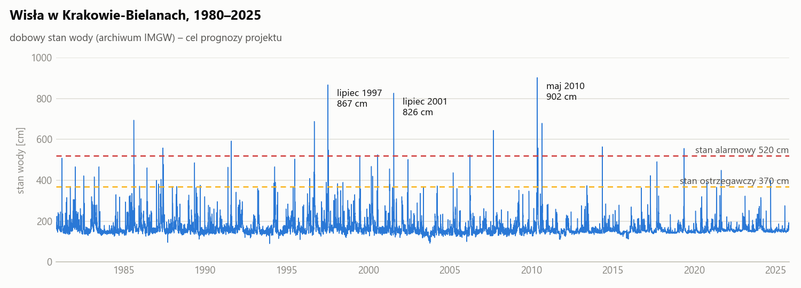
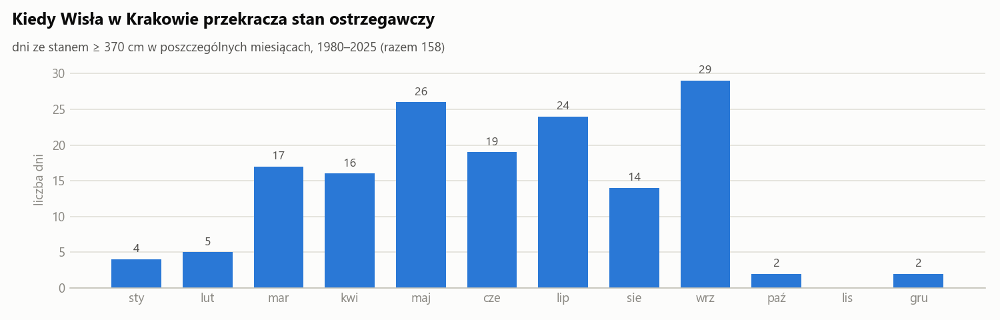
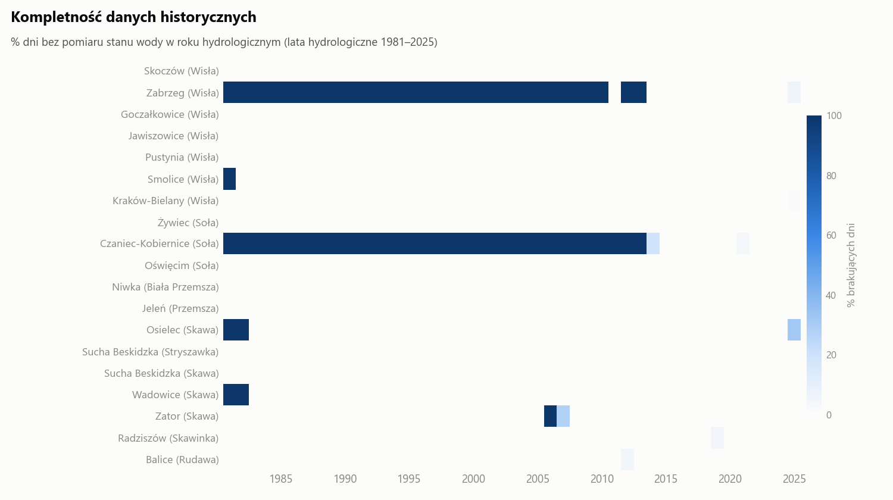

# RiverSense
A Machine Learning-Based System for River Water Level Prediction Using Hydrological and Weather Data

Prognoza stanu wody na Wiśle w Krakowie (wodowskaz **Kraków-Bielany**) na **1–3 dni do przodu**
z ostrzeżeniem przy stanie ostrzegawczym (**370 cm**) i alarmowym (**520 cm**). Model będzie korzystał
ze stanów wody na stacjach w górze rzeki i z opadów w zlewni.

<picture>
  <source media="(prefers-color-scheme: dark)" srcset="docs/img/bielany_levels_dark.png">
  
</picture>

## Stan projektu

| Etap | Stan |
|---|---|
| Wybór stacji i źródeł danych | ✅ zakończony |
| Pobranie danych historycznych | ✅ zakończony |
| Zbieranie danych na żywo | 🔄 trwa od 12.10.2026, co godzinę |
| Przygotowanie danych (preprocessing) | ✅ zakończony |
| Eksploracyjna analiza danych (EDA) | 🔄 w toku |
| Cechy, model, test na danych live | ⏳ planowane |

## Dane

### Źródła

| Źródło | Co zawiera | Okres | Rozdzielczość | Rola |
|---|---|---|---|---|
| Archiwum IMGW | stany wody 19 stacji, zjawiska lodowe | 1980–2025 | dobowa | trening i walidacja |
| ERA5 / ERA5-Land (Open-Meteo) | opad, deszcz, śnieg, pokrywa śnieżna, temperatura, wilgotność gleby w 7 punktach | 1980 – ok. 6 dni wstecz | godzinowa | trening i walidacja |
| API IMGW | bieżące stany wody, zjawiska lodowe, metadane stacji | od 12.10.2026 | godzinowa | test na żywo |
| Open-Meteo | prognoza pogody na 3 dni dla tych samych 7 punktów | od 12.10.2026 | godzinowa | test na żywo |
| IMGW | oficjalne ostrzeżenia hydrologiczne, obserwacje synoptyczne | od 12.10.2026 | godzinowa | porównanie z modelem |

W historii znamy faktyczny opad, ale działający system zna tylko jego prognozę. Dlatego prognozy
zapisujemy co godzinę dokładnie w takiej postaci, w jakiej były dostępne w danej chwili – test na żywo
pokaże, ile model traci, gdy zamiast faktycznego opadu dostaje prognozę.

### Stacje hydrologiczne

Zlewnia Wisły powyżej Krakowa: górna Wisła oraz dopływy Soła, Przemsza, Skawa, Skawinka i Rudawa.

| Stacja | Rzeka | W archiwum od | Rekord [cm] | Progi: ostrz. / alarm. [cm] | Braki 1980–2025 |
|---|---|---|---|---|---|
| **Kraków-Bielany** (cel prognozy) | Wisła | 1980 | 902 | 370 / 520 | 0,0% |
| Smolice | Wisła | 1970 | 848 | 450 / 630 | 2,2% |
| Pustynia | Wisła | 1970 | 752 | 330 / 480 | 0,0% |
| Jawiszowice | Wisła | 1950 | 825 | 480 / 630 | 0,0% |
| Goczałkowice | Wisła | 1950 | 687 | 290 / 410 | 0,0% |
| Skoczów | Wisła | 1950 | 356 | 210 / 260 | 0,0% |
| Oświęcim | Soła | 1950 | 671 | 370 / 460 | 0,0% |
| Żywiec | Soła | 1955 | 393 | 280 / 340 | 0,0% |
| Jeleń | Przemsza | 1950 | 428 | 280 / 330 | 0,0% |
| Niwka | Biała Przemsza | 1950 | 349 | 260 / 280 | 0,0% |
| Zator | Skawa | 1970 | 512 | 240 / 370 | 2,8% |
| Wadowice | Skawa | 1950 | 398 | 370 / 490 | 4,4% |
| Sucha Beskidzka | Skawa | 1950 | 473 | 215 / 285 | 0,0% |
| Osielec | Skawa | 1970 | 303 | 230 / 280 | 5,1% |
| Radziszów | Skawinka | 1970 | 630 | 310 / 400 | 0,1% |
| Balice | Rudawa | 1970 | 460 | 340 / 380 | 0,1% |
| *Zabrzeg* | *Wisła* | *2010* | *324* | *280 / 320* | *71,2%* |
| *Czaniec-Kobiernice* | *Soła* | *2013* | *399* | *320 / 450* | *73,8%* |
| *Sucha Beskidzka* | *Stryszawka* | *1970* | *385* | *220 / 270* | *0,0%* |

Trzy ostatnie stacje (kursywa) zostają w danych, ale nie będą głównymi cechami modelu: Zabrzeg
i Czaniec mają krótką historię, a Stryszawka od czerwca 2026 r. nie przysyła nowych odczytów.

### Punkty pogodowe

| Punkt | Obszar zlewni | Średni roczny opad 1981–2024 (ERA5) |
|---|---|---|
| `zywiec` | Soła | 1088 mm |
| `makow_podhalanski` | górna Skawa | 1036 mm |
| `wisla_beskidy` | źródła Wisły | 1018 mm |
| `oswiecim` | ujście Soły i Przemszy | 862 mm |
| `wadowice` | środkowa Skawa | 832 mm |
| `krakow` | Kraków | 773 mm |
| `katowice` | Przemsza | 752 mm |

Najwięcej pada w Beskidach (Soła, górna Skawa, źródła Wisły) – stamtąd przychodzą wezbrania.

## Co pokazują dane

**Wezbrania w Krakowie.** W latach 1980–2025 stan wody w Bielanach osiągnął poziom ostrzegawczy
(≥ 370 cm) w **158 dniach**, a alarmowy (≥ 520 cm) w **38 dniach**. Największe wezbrania: **902 cm**
(18.05.2010), 867 cm (10.07.1997) i 826 cm (26.07.2001). Typowy stan jest znacznie niższy: mediana to 156 cm, a w 80% dni stan mieści się w przedziale 142–210 cm.

<picture>
  <source media="(prefers-color-scheme: dark)" srcset="docs/img/seasonality_dark.png">
  
</picture>

**Sezonowość.** 92% dni z wysoką wodą przypada na marzec–wrzesień: wiosną wezbrania z roztopów
i opadów, latem z ulewnych deszczy w Beskidach. Od października do lutego stan ostrzegawczy był
osiągnięty tylko w 13 dniach. Dlatego w modelu zostają pokrywa śnieżna i temperatura, a dane live
zbierane jesienią raczej nie będą zawierać wezbrań – posłużą do testu działania systemu, nie do treningu.

<picture>
  <source media="(prefers-color-scheme: dark)" srcset="docs/img/completeness_dark.png">
  
</picture>

**Kompletność.** Bielany i większość stacji mają ciągłe szeregi od 1980 r. Braki to głównie pojedyncze
lata na początku okresu (Smolice, Osielec, Wadowice) i krótka historia Zabrzegu i Czańca. Pogoda ERA5
nie ma ani jednej brakującej godziny.

**Wstępna analiza cech** (gradient boosting, test na latach 2015–2025) – o jakości prognozy decydują głównie:
1. zmiana stanu wody w ostatniej dobie na stacjach w górze rzeki (prognoza na 1 dzień),
2. aktualny stan wody w Krakowie,
3. prognozowany opad na 48–72 h (prognoza na 2–3 dni).

## Co robi kod

### 1. Pobieranie danych

| Skrypt | Uruchamianie | Co robi |
|---|---|---|
| `collect.py` | co godzinę, GitHub Actions (`collect.yml`) | dopisuje do `data/live/` stany wody, metadane stacji, prognozy pogody, synop i ostrzeżenia IMGW |
| `fetch_historical.py` | ręcznie (`historical.yml`) | pobiera archiwum IMGW (stany wody, zjawiska lodowe) i pogodę ERA5; pogodę aktualizuje przyrostowo |

### 2. Przygotowanie danych – `src/data/`

Jedno polecenie `python -m src.data.build` (ok. 15 s) zamienia surowe pliki w czyste tabele w `data/processed/`.

Co dzieje się z danymi:
- **czas** – wszystko w UTC (IMGW zapisuje stany wody w UTC, a ostrzeżenia w czasie polskim),
- **pełna siatka** – każdy brakujący dzień lub godzina to wiersz z `NaN`, a nie pominięty wiersz,
- **błędy odczytu** – pojedynczy skok, którego nie widać na stacjach sąsiednich, jest usuwany;
  prawdziwe wezbrania i skoki przy zjawiskach lodowych (zator podnosi stan bez wzrostu przepływu) zostają,
- **krótkie luki** – uzupełniane interpolacją (≤ 3 dni w historii, ≤ 3 h w live) z flagą `is_imputed`,
- **dane live** – odrzucane przestarzałe odczyty, siatka godzinowa, wartość dobowa liczona jak w archiwum,
- **prognozy** – archiwum wszystkich prognoz i tabela „co model wiedział w danej chwili”,
- **kontrola jakości** – schematy tabel i kontrole treści; jeśli coś nie przejdzie, nic nie jest zapisywane.

| Tabela w `data/processed/` | Zawartość | Wiersze* |
|---|---|---|
| `levels_daily` | dobowe stany wody 19 stacji: historia + live, kolumna `source` | 312 tys. |
| `levels_daily_wide` | to samo w układzie data × stacja | 16 tys. |
| `levels_hourly` | godzinowe stany wody (live) | 2,8 tys. |
| `meteo_hourly` | pogoda godzinowa: ERA5 + analiza z prognozy dla ostatnich dni | 2,9 mln |
| `meteo_daily` | dobowe sumy i średnie pogody | 120 tys. |
| `forecast_archive` | wszystkie zapisane prognozy pogody | 86 tys. |
| `forecast_latest` | najnowsza prognoza znana przed daną godziną | 1,3 tys. |
| `stations` | stacje, sieć rzeczna, progi, rekordy | 19 |
| `synop_hourly`, `warnings` | obserwacje synoptyczne i ostrzeżenia IMGW | 425 / 100 |

\* stan na 18.10.2026; tabele live rosną z każdą godziną.

Przy każdym buildzie powstaje raport jakości `reports/data_quality.md`: braki i najdłuższe luki
każdej stacji, usunięte skoki, kandydaci na zmianę zera wodowskazu, braki w danych live.

### 3. Notatnik – `notebooks/RiverSense.ipynb`

Wstęp do projektu, import bibliotek, preprocessing krok po kroku z wynikami (wywołuje funkcje
z `src/data/`, sam niczego nie liczy) i początek EDA.

## Otwarte kwestie

- **Definicja doby IMGW** – nie wiadomo, czy stan dobowy w archiwum to odczyt poranny, czy średnia;
  przyjęto odczyt o 06 UTC (jedna stała w `src/data/config.py`).
- **Zmiany zera wodowskazu** – raport wskazuje 12 kandydatów (najwięcej w Wadowicach); do oceny w EDA.
- **Luka 11.2025–10.2026** – IMGW opublikuje stany wody za ten rok później; nie jest potrzebna do treningu.

## Uruchomienie

```bash
pip install -r requirements.txt
python -m src.data.build      # czyste tabele w data/processed/ + raport jakości
python docs/figures.py        # wykresy do README
```

Bot dopisuje dane co godzinę, więc przed pracą zawsze `git pull`. Plików w `data/` nie edytujemy ręcznie.

Więcej: opis plików i kolumn – [`docs/dane.md`](docs/dane.md), zasady czyszczenia –
[`docs/plan_czyszczenia_danych.md`](docs/plan_czyszczenia_danych.md).
